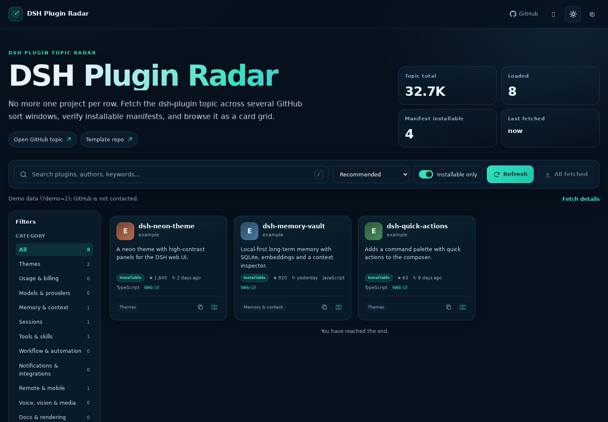

# DSH Plugin Radar · DSH 插件雷达

一个**纯静态、浏览器端实时抓取**的 GitHub topic 插件雷达。默认主题是 [`dsh-plugin`](https://github.com/topics/dsh-plugin)，它会把原本一行一个项目的 GitHub topic 页面重新编排成现代卡片网格，并用 `package.json` 的 `dsh.bundle` 清单过滤掉只打了 topic 的无关项目。



- 线上页面：<https://krutziy.github.io/dsh-pl-radar/>
- 不需要后端、不需要数据库、不需要 GitHub Actions。
- 不需要登录或 Token 也能用；数据直接由你的浏览器请求 GitHub。
- 页面本身只是一个可复制的模板：改 `assets/config.js` 里的 `topic` 就能套用到别的主题。

## 它解决什么问题

GitHub 的 topic 页面是纵向大列表，一个项目占一整行；而且 `dsh-plugin` 里混入了大量只是顺手加了 topic 的高 Star 项目。这个页面做了四件事：

1. **按多个顺序抓取**：Star 最多、最近更新、最近 90 天创建、最佳匹配，四个窗口交叉采样，去重后展示。
2. **按清单过滤**：读取每个候选仓库根目录的 `package.json`，只有声明了 `dsh.bundle.patch` 且版本合法的仓库才标为“清单可安装”。
3. **重新编排**：响应式卡片网格（桌面 4–5 列、平板 2–3 列、手机 1 列），滚动到底自动加载下一批，不再一行一个项目。
4. **按需抓取 + 全部抓取**：默认首次只抓一页，后续只有滚动到底/点击“加载更多”才继续请求 GitHub；工具栏的“全部抓取”可以一次性抓完剩余页面，并随时停止。

## 使用

打开 <https://krutziy.github.io/dsh-pl-radar/> 即可。页面不会在后台把 26 页全部抓完：

- 第一次打开只请求 **Star 窗口第 1 页**，并开始校验 `package.json`，通常几秒内出现首批卡片；
- 之后只有当你**滚动到底部**，或点击“加载更多”时，才请求下一个窗口/下一页；
- 请求顺序是 page 1 的 Star → 最近更新 → 最近 90 天 → 最佳匹配，然后 page 2 的同一顺序，依此类推；
- 每次只发一个搜索请求；这一页抓完后只校验该页仓库的 `package.json`，不会继续请求下一页；
- 未登录仍受 10 次/分钟限制，填 Token 后 30 次/分钟；
- 数据缓存在 IndexedDB，再次打开直接秒开，不会自动续抓；页面上的“刷新”会重置进度并重抓第一页。
- 想一次抓完：点工具栏的“全部抓取”。它会自动等待搜索限流，抓完所有 26 页后停止；运行中按钮会变成“停止抓取”。

### 可选 Token

页面的“设置”里可以填入 GitHub Token，只保存在本次浏览器会话（`sessionStorage`），只发送给 `api.github.com`。不填也能用，只是搜索配额从 **10 次/分钟** 提升到 **30 次/分钟**。

推荐创建一个 **fine-grained token**，只给 public repositories 的只读权限；不要使用带写权限的 Token。

## 本地运行

页面使用原生 ES Modules，没有构建步骤。不要直接双击 `index.html`（`file://` 下模块和 fetch 会受限），起一个静态服务器：

```sh
python3 -m http.server 8080
# 打开 http://localhost:8080/
```

只想看 UI、不想请求 GitHub：

```text
http://localhost:8080/?demo=1
```

## 配置成一个新模板

主要改 [`assets/config.js`](assets/config.js)：

```js
export const CONFIG = {
  topic: 'dsh-plugin',
  title: { zh: 'DSH 插件雷达', en: 'DSH Plugin Radar' },
  windows: [
    { id: 'stars', sort: 'stars', order: 'desc', pages: 10 },
    { id: 'updated', sort: 'updated', order: 'desc', pages: 10 },
    { id: 'new', query: () => `created:>=${isoDaysAgo(90)}`, sort: 'stars', pages: 3 },
    { id: 'best', pages: 3 },
  ],
  // ...
}
```

可以调整：

- `topic`：任意 GitHub topic；
- `windows`：抓取顺序、页数（每个查询最多 10 页 / 1,000 条）；
- `maxRepos`、`batchSize`；
- `verify.limit` / `verify.concurrency`：自动校验数量和并发；
- `categories`：分类 id、中文/英文标题、关键词。第一个命中的分类生效，`other` 放最后。

`?topic=...` 可以在不修改配置的情况下临时覆盖 topic。

## 部署到 GitHub Pages

1. 把仓库推送到 GitHub（默认分支 `main`）。
2. 仓库 **Settings → Pages → Build and deployment → Source: Deploy from a branch**，选择 **main / (root)**。
3. 等 1–2 分钟，访问 `https://<owner>.github.io/<repo>/`。

仓库里已经有 `.nojekyll`，不需要 Jekyll；所有资源使用相对路径，项目页子路径可以正常工作。

## 工作原理与限制

- **只走 GitHub Search API**：GitHub topic 的 HTML 没有 CORS，浏览器无法直接读取，因此使用官方 Search API；`raw.githubusercontent.com` 和 `cdn.jsdelivr.net` 用于读取 `package.json`，两者都允许跨域。
- **每个查询最多 1,000 条**：所以这不是全量 3.27 万条，而是多个窗口的 Top N 采样。页面会显示各窗口进度和覆盖数量。
- **未登录限流**：搜索 10 次/分钟；配额耗尽时显示错误和重试按钮，缓存不会丢。等待后点重试或继续滚动即可。填 Token 可提升到 30 次/分钟。
- **全部抓取**：会连续请求剩余页面，未登录时约 3 分钟（26 页、含限流等待）；运行中可随时停止。它会自动等待限流，不会丢掉已抓页面。
- **只校验仓库根清单**：monorepo 的插件如果放在 `packages/` 子目录，会被标为“仅 topic 标签”；页面的详情里会提示去仓库确认。
- **raw 网络回退**：`raw.githubusercontent.com` 不可达时自动尝试 jsDelivr；两者都失败会标记 `unreachable`，不会阻塞其他卡片。
- **不是安全审计**：“清单可安装”只代表仓库声明了 `dsh.bundle.patch`，不保证代码安全。安装插件会以你的权限执行第三方代码。
- **没有服务端缓存**：每个访客用自己的网络和 GitHub 配额；页面不做统计、不收集数据。

## 安全

- 页面无后端、无账号、无 Cookie、无第三方统计。
- 所有 GitHub 文本通过 `textContent` 渲染；链接只允许 `http(s)`；外链带 `rel="noopener noreferrer"`。
- `index.html` 带有 CSP（`script-src 'self'`、`style-src 'self'`、`connect-src` 白名单），没有内联脚本/样式。
- Token 不写入仓库、不写入 URL、不发送给 GitHub 之外的域名。

## 测试

```sh
npm test        # node --test tests/*.test.mjs
npm run check   # HTML/CSP/资源/密钥泄漏静态检查
```

测试覆盖清单解析、跨窗口去重、筛选/排序、分页批大小、URL 状态、i18n 中英文 key 对齐等。

## 数据与许可

- 代码：[MIT](LICENSE)。
- 仓库信息、描述、topics 来自 GitHub 公开 API；`package.json` 来自对应仓库。页面只做展示和链接，不重新分发插件代码。
- 本项目与 GitHub、DeepSeek 均无隶属关系。
- 如果你 fork 这个模板，请保留免责声明，并自行确认目标 topic 的数据使用方式。

## 相关链接

- [GitHub topic: dsh-plugin](https://github.com/topics/dsh-plugin)
- [DeepSeek Harness](https://github.com/deepseek-ai/deepseek-harness)
- [GitHub Search API rate limits](https://docs.github.com/en/rest/search/search#rate-limit)
- [GitHub Pages limits](https://docs.github.com/en/pages/getting-started-with-github-pages/github-pages-limits)
